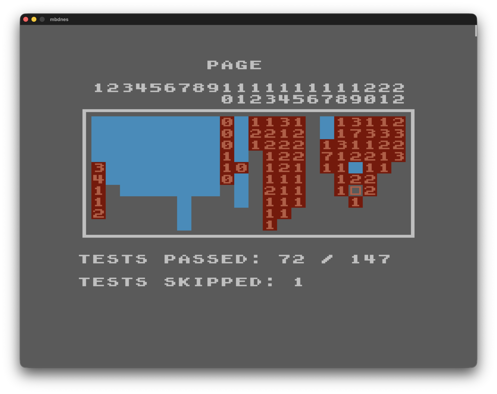

# mbdnes

## Hi

This is a work in progress; it can probably play most NES games just fine, but cycle perfection definitely isn't a thing (yet?) and I haven't tested everything thoroughly.

It's also my first substantial C++ project, so it probably has some structural/code issues I'd be happy to be made aware of.

Here's how it fares on [AccuracyCoin](https://github.com/100thCoin/AccuracyCoin):

## Building

### Prerequisites

You'll probalby need SDL2 installed somewhere. And cmake.

### Commands 

`cmake -DCMAKE_BUILD_TYPE=Release -B build --fresh`

`cmake --build build -j`

If you're on Windows...idk gl

## Running

`cd build`

`./mbdnes`
